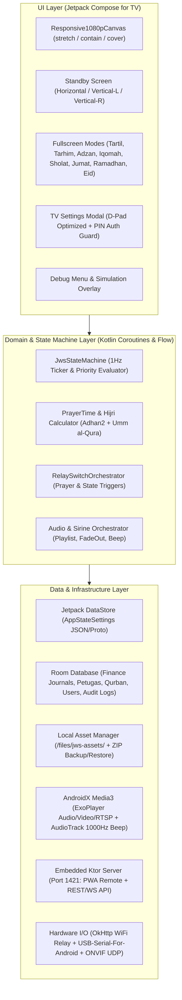
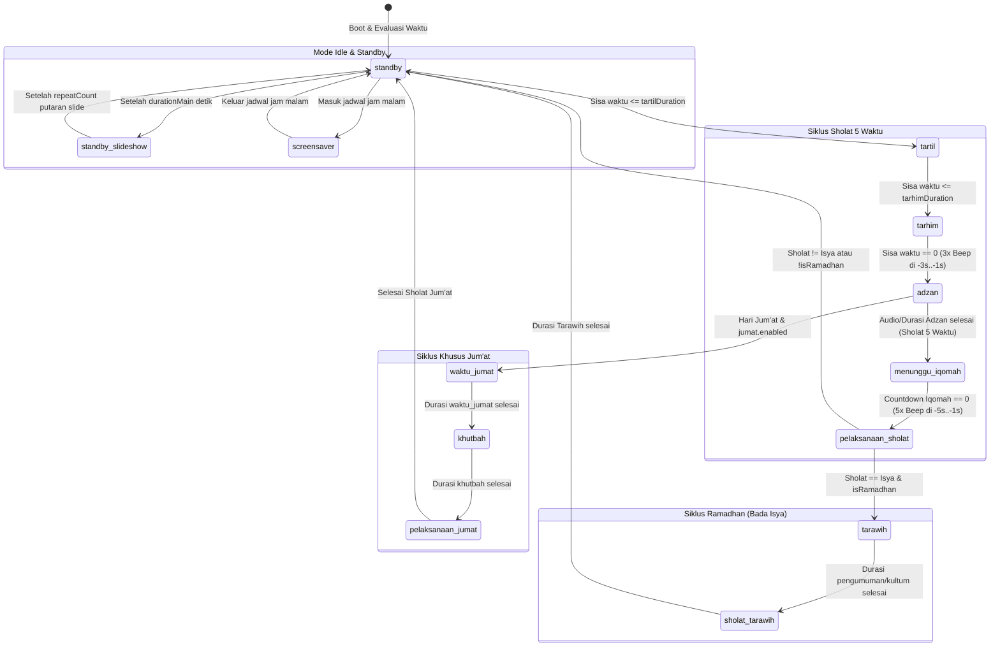
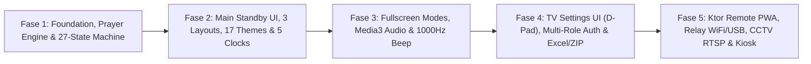

# Product Requirements Document (PRD)
## Rewrite Aplikasi JWS TV Masjid Al-Gaffar ke Native Android (Jetpack Compose for TV)

| Metadata Dokumen | Detail |
| :--- | :--- |
| **Nama Produk** | JWS TV Masjid Al-Gaffar (Native Android TV Edition) |
| **Repositori Referensi** | [jws-tv-al-gaffar](file:///d:/Ngoding/alGaffar_tv/_referensi_lama/README.md) (`Tauri v2 + React 19 + TypeScript`) |
| **Target Platform** | Android TV, Google TV, Android TV Box / STB, Tablet & Mini PC Android (Hybrid D-Pad + Touchscreen) |
| **Application ID** | `id.algaffar.jwstv` |
| **Target Tech Stack** | Kotlin, Jetpack Compose (`Material3` + `TV Foundation`), Media3 ExoPlayer, Ktor Server, Adhan2 |
| **Resolusi Referensi** | `1920 x 1080` px (Full HD 16:9 Landscape) dengan Adaptive Canvas Scaler |
| **Status Dokumen** | **Final v1.1 — Disetujui (Approved)** |

---

## 1. Executive Summary & Visi Produk

**JWS TV Masjid Al-Gaffar** adalah sistem informasi digital masjid (*Digital Signage* & *Jadwal Waktu Sholat*) pintar yang dirancang untuk beroperasi **24 jam sehari, 7 hari seminggu (24/7)** di layar televisi masjid. Aplikasi ini tidak sekadar menampilkan jam dan jadwal sholat, melainkan mengorkestrasi seluruh siklus ibadah harian dan tahunan masjid: mulai dari pemutaran otomatis Tartil & Tarhim, hitung mundur Adzan & Iqomah, mode tenang saat pelaksanaan sholat dengan pantauan CCTV, mode khusus Hari Jum'at, Ramadhan (Tarawih, Ta'jil, Sirine Imsak/Buka), Hari Raya (Idul Fitri, Idul Adha, Qurban), transparansi keuangan masjid (manual & sinkronisasi Google Sheets), hingga otomatisasi saklar listrik/perangkat audio masjid (Relay) dan kendali jarak jauh (*Remote Control*) melalui smartphone pengurus DKM.

### Mengapa Rewrite ke Native Android Jetpack Compose?
Versi saat ini dibangun menggunakan **Tauri v2 (Rust) + React 19 + Tailwind CSS v4 + Framer Motion** ([package.json](file:///d:/Ngoding/alGaffar_tv/_referensi_lama/package.json), [Cargo.toml](file:///d:/Ngoding/alGaffar_tv/_referensi_lama/src-tauri/Cargo.toml)). Meskipun arsitektur tersebut sangat baik untuk Mini PC Desktop (Linux/Windows), menjalankannya di perangkat **Android TV / STB (Set-Top Box)** yang umumnya memiliki spesifikasi terbatas (RAM 1–2 GB, SoC ARM Cortex-A53/A55) menimbulkan sejumlah kendala struktural:

> [!WARNING]
> **Kendala Utama Arsitektur WebView (Tauri) di Android TV Box:**
> 1. **Overhead Memori & GPU WebView**: Animasi CSS kompleks (`backdrop-filter: blur`, partikel, *aurora gradients*, `framer-motion`) di atas Android System WebView memakan RAM tinggi (400–700 MB) dan rentan menyebabkan *frame drop* atau *Out-Of-Memory (OOM) crash* pada pemakaian 24/7.
> 2. **Dual Audio Engine Workaround**: Pada kode lama ([AudioPlayer.tsx](file:///d:/Ngoding/alGaffar_tv/_referensi_lama/src/components/Audio/AudioPlayer.tsx) & [audio.rs](file:///d:/Ngoding/alGaffar_tv/_referensi_lama/src-tauri/src/audio.rs)), pemutaran audio terpecah antara HTML5 `<audio>` (untuk Android) dan Rust `rodio` (untuk Linux/Windows) karena keterbatasan *autoplay policy* dan akses audio hardware di WebView.
> 3. **Overhead Streaming CCTV via Base64 Polling**: Di versi lama ([CctvSlide.tsx](file:///d:/Ngoding/alGaffar_tv/_referensi_lama/src/components/Screens/Shared/CctvSlide.tsx)), stream kamera IP di-poll sebagai snapshot JPEG melalui bridge lalu dikirim sebagai string Base64 ke React setiap 100–1000ms. Ini membebani CPU dan *Garbage Collector*.
> 4. **Navigasi D-Pad Remote TV**: Mengelola fokus *spatial navigation* (Atas/Bawah/Kiri/Kanan/OK/Back) di DOM HTML menggunakan listener keyboard manual ([SettingsModal.tsx](file:///d:/Ngoding/alGaffar_tv/_referensi_lama/src/components/Settings/SettingsModal.tsx)) rawan kehilangan fokus (*focus trap*).
> 5. **Keterbatasan Akses Hardware di Android**: Fitur USB Serial Relay di kode Rust ([handlers.rs](file:///d:/Ngoding/alGaffar_tv/_referensi_lama/src-tauri/src/server/handlers.rs)) dinonaktifkan pada target Android (`#[cfg(not(target_os = "android"))]`), sehingga STB Android tidak bisa mengontrol modul relay USB secara langsung.

Dengan menulis ulang (*rewrite*) aplikasi secara native menggunakan **Kotlin & Jetpack Compose for TV**:
- **Performa Grafis Native (Skia/Impeller GPU)**: Konsumsi RAM ditekan ke kisaran **< 180 MB**, animasi transisi 60 FPS stabil, dan *shader/canvas rendering* langsung dieksekusi di GPU.
- **Native Media3 (`ExoPlayer`)**: Pemutaran audio (Tartil/Tarhim/Adzan), video promosi/edukasi, serta stream **RTSP / MJPEG / HLS CCTV** berjalan dengan *hardware decoding* tanpa konversi Base64.
- **First-Class TV D-Pad Navigation**: Fokus remote TV ditangani secara deklaratif oleh `androidx.tv.material3` dan `FocusRequester`.
- **Dukungan Penuh Kiosk & USB OTG Android**: Auto-boot saat listrik menyala (`BOOT_COMPLETED`), proteksi *WakeLock*, serta dukungan langsung **USB OTG Serial Relay** (CH340/CP210x/FTDI) di Android TV Box.

---

## 2. Analisis Arsitektur Eksisting (Baseline Reference)

Berikut adalah pemetaan modul dari kode sumber referensi (`_referensi_lama`) yang menjadi acuan *100% Feature Parity*:

| Domain / Modul | File Referensi Utama (Tauri + React) | Tanggung Jawab Utama |
| :--- | :--- | :--- |
| **State & Konfigurasi Utama** | [appState.ts](file:///d:/Ngoding/alGaffar_tv/_referensi_lama/src/types/appState.ts), [AppStateContext.tsx](file:///d:/Ngoding/alGaffar_tv/_referensi_lama/src/contexts/AppStateContext.tsx) | Definisi 27 state aplikasi (`AppState`), struktur JSON `AppStateSettings`, migrasi versi schema, dan sinkronisasi state. |
| **Mesin State (State Machine)** | [stateMachine.ts](file:///d:/Ngoding/alGaffar_tv/_referensi_lama/src/contexts/appState/stateMachine.ts), [coreTransitions.ts](file:///d:/Ngoding/alGaffar_tv/_referensi_lama/src/contexts/appState/logic/coreTransitions.ts), [specialTransitions.ts](file:///d:/Ngoding/alGaffar_tv/_referensi_lama/src/contexts/appState/logic/specialTransitions.ts), [holidayTransitions.ts](file:///d:/Ngoding/alGaffar_tv/_referensi_lama/src/contexts/appState/logic/holidayTransitions.ts) | Evaluasi transisi state setiap 1 detik (`1Hz tick`), prioritas state, serta *crash/reboot recovery* saat jam sholat sudah lewat. |
| **Kalkulasi Sholat & Hijriah** | [PrayerTimeContext.tsx](file:///d:/Ngoding/alGaffar_tv/_referensi_lama/src/contexts/PrayerTimeContext.tsx), [prayerSettings.ts](file:///d:/Ngoding/alGaffar_tv/_referensi_lama/src/types/prayerSettings.ts), [hijri.ts](file:///d:/Ngoding/alGaffar_tv/_referensi_lama/src/utils/hijri.ts) | Perhitungan 8 waktu (Imsak, Subuh, Syuruq, Dhuha, Dzuhur, Ashar, Maghrib, Isya), koreksi ihtiyati, kalender Hijriah (+1 hari bada Maghrib), deteksi puasa sunnah & PHBI. |
| **Layout, Tema & Jam Artistik** | [LayoutContext.tsx](file:///d:/Ngoding/alGaffar_tv/_referensi_lama/src/contexts/LayoutContext.tsx), [ThemeContext.tsx](file:///d:/Ngoding/alGaffar_tv/_referensi_lama/src/contexts/ThemeContext.tsx), [themes.ts](file:///d:/Ngoding/alGaffar_tv/_referensi_lama/src/types/themes.ts), [ArtisticClocks.tsx](file:///d:/Ngoding/alGaffar_tv/_referensi_lama/src/components/Utils/ArtisticClocks.tsx) | 3 posisi layout (`horizontal`, `vertical-left`, `vertical-right`), 17 tema bawaan + kustom, rotasi otomatis, dan 5 gaya jam artistik (`classic`, `golden`, `glass`, `wood`, `neon`). |
| **Layar Utama (Standby)** | [MainContent.tsx](file:///d:/Ngoding/alGaffar_tv/_referensi_lama/src/components/Screens/Main/MainContent.tsx), [Header.tsx](file:///d:/Ngoding/alGaffar_tv/_referensi_lama/src/components/Screens/Header/Header.tsx), [PrayerTimesList.tsx](file:///d:/Ngoding/alGaffar_tv/_referensi_lama/src/components/Screens/PrayerTimes/PrayerTimesList.tsx), [OverlayText.tsx](file:///d:/Ngoding/alGaffar_tv/_referensi_lama/src/components/Screens/OverlayText/OverlayText.tsx) | Dashboard utama: Brand masjid, jam, tanggal Masehi/Hijriah, 2 kartu `InfoRotator`, `NextPrayer` countdown, carousel jadwal sholat (4 terlihat dari 8), slideshow utama, dan running text. |
| **Layar Fullscreen Ibadah** | [FullScreen/index.tsx](file:///d:/Ngoding/alGaffar_tv/_referensi_lama/src/components/Screens/FullScreen/index.tsx), [TartilTarhimFullscreen.tsx](file:///d:/Ngoding/alGaffar_tv/_referensi_lama/src/components/Screens/FullScreen/TartilTarhimFullscreen.tsx), [AdzanContent.tsx](file:///d:/Ngoding/alGaffar_tv/_referensi_lama/src/components/Screens/FullScreen/AdzanContent.tsx), [IqomahContent.tsx](file:///d:/Ngoding/alGaffar_tv/_referensi_lama/src/components/Screens/FullScreen/IqomahContent.tsx), [WaktuJumatContent.tsx](file:///d:/Ngoding/alGaffar_tv/_referensi_lama/src/components/Screens/FullScreen/WaktuJumatContent.tsx), [TarawihContent.tsx](file:///d:/Ngoding/alGaffar_tv/_referensi_lama/src/components/Screens/FullScreen/TarawihContent.tsx), [IdulFitriContent.tsx](file:///d:/Ngoding/alGaffar_tv/_referensi_lama/src/components/Screens/FullScreen/IdulFitriContent.tsx), [IdulAdhaContent.tsx](file:///d:/Ngoding/alGaffar_tv/_referensi_lama/src/components/Screens/FullScreen/IdulAdhaContent.tsx) | Tampilan khusus untuk setiap fase ibadah, termasuk siluet masjid saat Adzan, peringatan larangan sholat sunnah 2 menit sebelum Iqomah, layar Khutbah/Sholat dengan overlay CCTV (`CctvStateOverlay`), tabel petugas & keuangan. |
| **Sistem Audio & Sirine** | [AudioPlayer.tsx](file:///d:/Ngoding/alGaffar_tv/_referensi_lama/src/components/Audio/AudioPlayer.tsx), [useSirine.ts](file:///d:/Ngoding/alGaffar_tv/_referensi_lama/src/hooks/useSirine.ts), [audio.rs](file:///d:/Ngoding/alGaffar_tv/_referensi_lama/src-tauri/src/audio.rs) | Resolusi playlist per waktu sholat, auto-sync durasi Tarhim & Adzan dari metadata panjang file MP3, *volume fade-out* 3 detik terakhir, beep 1000Hz (3x sebelum Adzan, 5x sebelum Iqomah), Sirine Ramadhan, dan jadwal audio kustom. |
| **Saklar Otomatis (Relay)** | [SwitchController.tsx](file:///d:/Ngoding/alGaffar_tv/_referensi_lama/src/components/SwitchController.tsx), [switchSettings.ts](file:///d:/Ngoding/alGaffar_tv/_referensi_lama/src/types/switchSettings.ts) | Kontrol 8 channel relay (`lampu_dalam`, `lampu_luar`, `ac_1..3`, `audio_luar`, `audio_dalam`, `saklar_8`) berbasis offset waktu sholat atau transisi state via WiFi HTTP atau USB Serial. |
| **Server Remote & Keamanan** | [server/mod.rs](file:///d:/Ngoding/alGaffar_tv/_referensi_lama/src-tauri/src/server/mod.rs), [handlers.rs](file:///d:/Ngoding/alGaffar_tv/_referensi_lama/src-tauri/src/server/handlers.rs), [AuthContext.tsx](file:///d:/Ngoding/alGaffar_tv/_referensi_lama/src/contexts/AuthContext.tsx), [backup.rs](file:///d:/Ngoding/alGaffar_tv/_referensi_lama/src-tauri/src/backup.rs) | Server HTTP lokal port `1421` untuk PWA Remote di HP, autentikasi Bearer Token (QR Code), rate-limiting, autentikasi PIN multi-role (`superadmin`, `admin`, `user`), serta Backup/Restore `.zip`. |

---

## 3. Target Tech Stack & Arsitektur Android (Jetpack Compose)

### 3.1. Diagram Arsitektur Sistem

### 3.2. Spesifikasi Pustaka (Libraries & Dependencies)

| Komponen | Library / Teknologi Android | Alasan Pemilihan & Keunggulan |
| :--- | :--- | :--- |
| **Minimum / Target SDK** | `minSdk = 26` (Android 8.0 Oreo), `targetSdk = 35` | Mencakup >98% Android TV Box / STB di pasaran dan mendukung penuh API `java.time` (termasuk `HijrahDate`). |
| **UI Framework** | **Jetpack Compose** + **Compose for TV** (`androidx.tv:tv-material`, `androidx.tv:tv-foundation`) | Komponen native khusus TV dengan pengelolaan D-Pad focus, *focus glow/scale*, dan performa tinggi tanpa WebView. |
| **Architecture & DI** | **MVVM / MVI** + **Hilt** (`dagger.hilt.android`) + **Kotlin Coroutines / StateFlow** | Arsitektur reaktif satu arah (*Unidirectional Data Flow*). Seluruh perubahan state waktu sholat dan konfigurasi mengalir via `StateFlow`. |
| **Kalkulasi Waktu Sholat** | **Adhan2** (`com.batoulapps.adhan:adhan2`) | Library resmi Kotlin Multiplatform dari kreator `adhan-js` yang dipakai di versi lama—menjamin hasil waktu sholat **100% identik** hingga ke detik. |
| **Kalender Hijriah** | `java.time.chrono.HijrahChronology` (Umm al-Qura) + Fallback Algoritma Kuwaiti | Bawaan standar JDK8+/Android API 26+, akurat, tanpa dependensi eksternal berat. |
| **Media, Audio & CCTV** | **AndroidX Media3 (`ExoPlayer` + `Media3 RTSP`)** + `AudioTrack` | Mendukung playlist MP3 gapless, pembacaan durasi file akurat, *volume ramping/fade-out*, pemutaran video lokal, serta streaming **RTSP / HLS / MJPEG** kamera CCTV secara hardware-accelerated. `AudioTrack` menghasilkan gelombang sinus 1000Hz murni tanpa latensi. |
| **Camera USB (UVC)** | **CameraX** (`androidx.camera:camera-camera2`, `camera-External`) | Menampilkan input webcam/capture card HDMI-to-USB yang ditancapkan ke port USB TV Box. |
| **YouTube Live Stream** | `com.pierfrancescosoffritti.androidyoutubeplayer:core` (atau Media3 HLS Extractor) | Memutar siaran langsung Makkah/Madinah secara stabil di dalam komponen Compose `AndroidView`. |
| **Local HTTP Remote Server** | **Ktor Server (`ktor-server-cio` / `netty`, `ktor-server-websockets`, `ktor-server-auth`)** | Menggantikan server Rust `tiny_http` di port `1421`. Sangat ringan, mendukung WebSocket untuk update status real-time ke HP tanpa polling berat, dan menyajikan bundel PWA Remote. |
| **Penyimpanan Data** | **Jetpack DataStore** (`kotlinx.serialization`) + **Room Database** | DataStore menyimpan konfigurasi pengaturan global dan mendukung skema JSON yang kompatibel dengan file backup versi lama. Room menyimpan data relasional/historis (jurnal kas Jumat/Ramadhan, jadwal petugas, grup qurban). |
| **Excel Import / Export** | **FastExcel** (`org.dhatim:fastexcel-reader`) atau **Apache POI Light / CSV Parser** | Membaca dan mengekspor template `.xlsx` untuk jadwal Ta'jil 30 hari, jadwal petugas, dan laporan keuangan (menggantikan `SheetJS/xlsx`). |
| **Kontrol Relay USB & WiFi** | **OkHttp** + **usb-serial-for-android** (`com.github.mik3y:usb-serial-for-android`) | Mengaktifkan kembali fitur **USB Serial Relay** (Arduino/CH340/FTDI) langsung dari port USB Android TV Box selain mode WiFi HTTP Relay. |
| **Image Loading & QR** | **Coil 3** (`io.coil-kt.coil3:coil-compose`) + **ZXing** (`com.google.zxing:core`) | Caching gambar background/slide dengan hemat memori dan pembuatan QR Code vektor tajam untuk Infaq Masjid & koneksi Remote. |

---

## 4. Spesifikasi Fungsional Lengkap (Functional Requirements)

### 4.1. Mesin State Utama (27-State JWS State Machine)

Inti dari aplikasi adalah mesin state deterministik yang dievaluasi setiap **1 detik (`1000ms` ticker)** berdasarkan waktu saat ini (`LocalDateTime`), jadwal waktu sholat hari ini, dan konfigurasi aktif.

#### Daftar Lengkap 27 State (`AppState`)
1. **Kelompok Idle & Standby**:
   - `standby`: Layar dashboard utama (Header, Jam, InfoRotator, NextPrayer, Jadwal Sholat, Slide).
   - `standby_slideshow`: Layar slideshow gambar/video layar penuh yang bergantian dengan `standby` berdasarkan `durationMain` (detik di layar utama) dan `repeatCount` (jumlah putaran seluruh slide sebelum kembali ke `standby`).
   - `screensaver`: Mode malam layar gelap hemat daya dengan jam melayang (*floating clock* anti-*burn-in*), aktif otomatis berdasarkan daftar jadwal rentang waktu (misal `21:30` s/d `03:00`).
2. **Kelompok Siklus Sholat 5 Waktu (`fajr`, `dhuhr`, `asr`, `maghrib`, `isha`)**:
   - `tartil`: Aktif `tartilDuration` menit sebelum waktu Adzan. Memutar playlist murottal dari folder `audio/tartil/{prayerId}/`.
   - `tarhim`: Aktif `tarhimDuration` menit sebelum waktu Adzan. **Auto-Sync Durasi**: Durasi aktual ditentukan oleh panjang file audio `audio/tarhim/{prayerId}.mp3` sehingga pembacaan shalawat tarhim selesai tepat pada detik `00:00` masuknya waktu Adzan. Memicu **3x Beep (1000Hz)** pada sisa waktu `3s`, `2s`, `1s`.
   - `adzan`: Aktif tepat saat waktu sholat tiba (`secondsToPrayer <= 0`). Jika `isAdzan = true`, memutar audio adzan dan durasi state mengikuti panjang file audio; jika `isAdzan = false` (hanya penanda visual karena muadzin adzan langsung), durasi mengikuti `adzanDuration` menit.
   - `menunggu_iqomah`: Hitung mundur menuju pelaksanaan sholat berjamaah sesuai `iqomahDuration` menit. Menampilkan banner peringatan merah pada sisa waktu `<= 120 detik` (`"Iqomah segera tiba... HARAP TIDAK MEMULAI SHOLAT SUNNAT"`). Memicu **5x Beep (1000Hz)** pada sisa waktu `5s`, `4s`, `3s`, `2s`, `1s`.
   - `pelaksanaan_sholat`: Berlangsung selama `sholatDuration` menit. Menampilkan layar tenang (`CctvStateOverlay` jika kamera diaktifkan, atau siluet masjid tenang), nama Imam bertugas, dan pesan *"Rapatkan Shaf dan Matikan Gadget"*.
3. **Kelompok Khusus Hari Jum'at (Menggantikan Dzuhur saat `jumat.enabled = true` pada hari Jum'at)**:
   - `waktu_jumat`: Aktif setelah Tarhim/Adzan pertama selesai (default 12 menit). Merotasi slide: **Petugas Jum'at** (Khotib, Imam, Muadzin), **Laporan Keuangan Jum'at**, dan slide pengumuman bertanda `showInJumat`.
   - `khutbah`: Layar tenang pelaksanaan Khutbah Jum'at (default 30 menit) dengan nama Khotib dan pantauan CCTV opsional.
   - `pelaksanaan_jumat`: Layar tenang pelaksanaan Sholat Jum'at (default 20 menit) dengan nama Imam.
4. **Kelompok Khusus Ramadhan (`ramadhan.isRamadhan = true`)**:
   - `tarawih`: Aktif otomatis tepat setelah `pelaksanaan_sholat` Isya selesai (default 15 menit untuk pengumuman/kultum). Merotasi slide: **Petugas Tarawih** (Penceramah malam ke-N, Imam Tarawih, Imam Witir), **Keuangan Ramadhan**, **Jadwal Imsak & Buka Esok Hari**, **Daftar Penyumbang Ta'jil**, atau **Laporan Akhir Ramadhan**.
   - `sholat_tarawih`: Layar tenang pelaksanaan Sholat Tarawih & Witir (default 45 menit).
5. **Kelompok Hari Raya & Qurban (Prioritas Tertinggi pada Rentang `timeSlots`)**:
   - `idul_fitri` ↔ `idul_fitri_standby`: Rotasi informasi petugas & kas Idul Fitri dengan layar standby selama rentang `timeSlots` aktif. Saat rentang `timeSlots` berakhir, otomatis masuk ke `sholat_idul_fitri` → `khutbah_idul_fitri`.
   - `idul_adha` ↔ `idul_adha_standby`: Rotasi informasi petugas & grup peserta Qurban (`QurbanGroup`) dengan layar standby selama `timeSlots` aktif, diikuti otomatis oleh `sholat_idul_adha` → `khutbah_idul_adha`.
   - `info_qurban` ↔ `info_qurban_standby`: Rotasi daftar kelompok Qurban Sapi/Kambing pada jam-jam sosialisasi harian yang dijadwalkan.
6. **Kelompok Layar Khusus (Terjadwal / Manual via Remote)**:
   - `live`: Siaran langsung YouTube (Makkah / Madinah / Kustom).
   - `cctv`: Tampilan penuh matriks kamera CCTV (`1`, `2`, `4`, atau `8` grid).
   - `masjid_qr`: Tampilan penuh QRIS / QR Code donasi & infaq masjid.
   - `online_finance`: Tampilan penuh laporan keuangan *real-time* dari Google Sheets / API.

#### Diagram Alur Transisi State (`JwsStateMachine`)

> [!IMPORTANT]
> **Fitur Wajib: Past-Prayer-Time Persistence & Crash Recovery**
> Sebagaimana diimplementasikan pada [coreTransitions.ts](file:///d:/Ngoding/alGaffar_tv/_referensi_lama/src/contexts/appState/logic/coreTransitions.ts) dan [specialTransitions.ts](file:///d:/Ngoding/alGaffar_tv/_referensi_lama/src/contexts/appState/logic/specialTransitions.ts), jika TV baru menyala atau mengalami *reboot* setelah listrik padam **di tengah rangkaian waktu sholat** (misalnya pukul 12:18 saat waktu Dzuhur jatuh pada pukul 12:05), aplikasi **TIDAK BOLEH** diam di layar `standby`. Mesin state wajib menghitung selisih waktu yang telah berlalu sejak waktu Adzan (`elapsedSeconds = now - prayerTime`) dan langsung melompat ke state yang sesuai (`adzan`, `menunggu_iqomah`, `pelaksanaan_sholat`, `waktu_jumat`, `khutbah`, atau `tarawih`) beserta **sisa detik hitung mundur yang akurat**.

---

### 4.2. Mesin Kalkulasi Waktu Sholat, Hijriah & Hari Besar Islam (PHBI)

1. **Perhitungan Jadwal Sholat ([PrayerTimeContext.tsx](file:///d:/Ngoding/alGaffar_tv/_referensi_lama/src/contexts/PrayerTimeContext.tsx))**:
   - Menggunakan koordinat `latitude`, `longitude`, dan zona waktu (`Asia/Jakarta`, `Asia/Makassar`, `Asia/Jayapura`, `Asia/Singapore`, `Asia/Kuala_Lumpur`).
   - Mendukung **12 Metode Kalkulasi** (`Singapore` [Default/Kemenag], `MuslimWorldLeague`, `Egyptian`, `Karachi`, `UmmAlQura`, `Dubai`, `MoonsightingCommittee`, `NorthAmerica`, `Kuwait`, `Qatar`, `Tehran`, `Turkey`) dan **2 Madzhab** (`Shafi`, `Hanafi`).
   - Menghasilkan **8 Waktu Harian**:
     - `Imsak` = `Subuh (Fajr) - 10 menit`
     - `Subuh (Fajr)`
     - `Syuruq (Sunrise)`
     - `Dhuha` = `Syuruq (Sunrise) + 20 menit`
     - `Dzuhur` (otomatis berganti label menjadi **`Jum'at`** pada hari Jum'at)
     - `Ashar`
     - `Maghrib`
     - `Isya`
   - **Sistem Koreksi Waktu**:
     - Koreksi spesifik per waktu sholat (`-10` s/d `+10` menit).
     - Koreksi pengaman global `ihtiyati` (`-5` s/d `+5` menit) yang ditambahkan ke Imsak dan 5 waktu sholat fardhu (tidak mengubah Syuruq dan Dhuha).
2. **Kalender Hijriah & Pergantian Hari Saat Maghrib ([hijri.ts](file:///d:/Ngoding/alGaffar_tv/_referensi_lama/src/utils/hijri.ts), [Tanggal.tsx](file:///d:/Ngoding/alGaffar_tv/_referensi_lama/src/components/Screens/Header/Tanggal.tsx))**:
   - Menggunakan kalender **Umm al-Qura** dengan opsi koreksi manual `hijriAdjustment` (`-3` s/d `+3` hari).
   - **Aturan Pergantian Hari Islam**: Begitu waktu saat ini melewati waktu **Maghrib** hari ini (`now >= maghribTime`), tanggal Hijriah yang ditampilkan di layar dan yang digunakan untuk kalkulasi puasa/PHBI esok hari **otomatis bertambah +1 hari**.
3. **Deteksi Otomatis Puasa Sunnah & PHBI (Lookahead 60 Hari)**:
   - Menampilkan pengingat puasa sunnah untuk hari ini dan esok hari: Puasa Senin-Kamis, Puasa Ayyamul Bidh (tanggal 13, 14, 15 setiap bulan Hijriah, **kecuali** Hari Tasyrik 11–13 Dzulhijjah), Puasa 6 Hari Bulan Syawal, Puasa Tasu'a & Asyura (9–10 Muharram), dan Puasa Arafah (9 Dzulhijjah).
   - Menampilkan hitung mundur menuju 12 Hari Besar Islam terdekat dalam 60 hari ke depan (Tahun Baru Islam, Maulid Nabi, Isra Mi'raj, Nisfu Sya'ban, Awal Ramadhan, Nuzulul Qur'an, Idul Fitri, Idul Adha, dll.).

---

### 4.3. Layar Utama (Standby), Tata Letak (Layouts), Tema & Jam Artistik

1. **Kanvas Adaptif `1920x1080` ([ResponsiveScaler.tsx](file:///d:/Ngoding/alGaffar_tv/_referensi_lama/src/components/ResponsiveScaler.tsx))**:
   - Seluruh UI dirancang pada koordinat logis `1920x1080 dp` dan diskalakan secara otomatis ke resolusi fisik TV (baik TV HD Ready `1280x720`, Full HD `1920x1080`, maupun 4K `3840x2160`) dengan 3 mode skala: `stretch` (penuh layar), `contain` (proporsional dengan letterbox), dan `cover`.
2. **3 Variasi Tata Letak (Layouts) & Auto-Rotate ([LayoutContext.tsx](file:///d:/Ngoding/alGaffar_tv/_referensi_lama/src/contexts/LayoutContext.tsx))**:
   - **`horizontal` (Default)**:
     - Atas: Header (Brand Masjid + Tanggal Masehi/Hijriah + Jam).
     - Tengah Kiri (75% lebar): Area Slide Utama (Gambar, Video, Jadwal Petugas, Laporan Keuangan, atau Live/CCTV).
     - Tengah Kanan (25% lebar): 3 kartu bertumpuk vertikal — `InfoRotator` (Info Masjid), `InfoRotator` (Info Kajian / Puasa Sunnah / PHBI), dan `NextPrayer` (Hitung mundur sholat berikutnya).
     - Bawah: Bar horizontal `PrayerTimesList` + `OverlayText` (Running Text).
   - **`vertical-left`**: Bar jadwal sholat vertikal di sisi kiri (25% lebar), area slide di kanan atas, dan 3 kartu info berjajar horizontal di bawah slide.
   - **`vertical-right`**: Bar jadwal sholat vertikal di sisi kanan (25% lebar), area slide di kiri atas, dan 3 kartu info di bawah slide.
   - **Auto-Layout Rotation**: Opsi untuk mengganti layout secara otomatis setiap **4 jam** guna mencegah kejenuhan visual dan *screen burn-in*.
3. **Carousel Jadwal Sholat ([PrayerTimesList.tsx](file:///d:/Ngoding/alGaffar_tv/_referensi_lama/src/components/Screens/PrayerTimes/PrayerTimesList.tsx))**:
   - Menampilkan **4 kartu waktu sholat sekaligus** dari total 8 waktu sholat dalam animasi geser melingkar (*seamless infinite circular carousel*) dengan jeda yang dapat diatur (`prayerTimeScrollInterval`, default 3 detik).
   - Kartu waktu sholat berikutnya (`nextPrayer`) diberi sorotan warna aksen aktif, efek *glow*, dan indikator lencana.
4. **17 Tema Bawaan + Tema Kustom & Auto-Theme ([themes.ts](file:///d:/Ngoding/alGaffar_tv/_referensi_lama/src/types/themes.ts))**:
   - Menyediakan 17 palet tema lengkap (`default`, `emerald`, `midnight`, `sunset`, `ocean`, `earth`, `luxury`, `minimal`, `royal-gold`, `deep-ocean`, `obsidian-emerald`, `purple-rain`, `aurora-night`, `islamic-marble`, `midnight-forest`, `royal-desert`, `cyber-silk`).
   - Mendukung pembuatan **Tema Kustom** (warna primer, sekunder, aksen, teks, gradien background, pola geometris Islam, dan tingkat keburaman kaca).
   - **Auto-Theme Rotation**: Mengacak urutan tema selama 24 jam tanpa pengulangan dan mengganti tema secara otomatis setiap pergantian jam atau setiap masuk waktu sholat.
5. **5 Gaya Jam Artistik ([ArtisticClocks.tsx](file:///d:/Ngoding/alGaffar_tv/_referensi_lama/src/components/Utils/ArtisticClocks.tsx))**:
   - Digambar menggunakan Compose `Canvas` berkinerja tinggi dengan 5 gaya: `classic` (minimalis tegas), `golden` (aksen emas mewah), `glass` (efek kaca transparan), `wood` (tekstur hangat), dan `neon` (cahaya cyber/modern). Masing-masing memiliki varian ukuran `header` dan varian besar `main` (untuk layar Tartil/Tarhim).

---

### 4.4. Sistem Audio, Beep Presisi & Sirine Ramadhan

1. **Resolusi Hierarki Playlist Audio ([AudioPlayer.tsx](file:///d:/Ngoding/alGaffar_tv/_referensi_lama/src/components/Audio/AudioPlayer.tsx))**:
   - Untuk setiap kategori (`tartil`, `tarhim`, `adzan`) dan waktu sholat (`fajr`, `dhuhr`, `asr`, `maghrib`, `isha`), sistem mencari file audio di direktori penyimpanan lokal aplikasi dengan urutan prioritas:
     1. Seluruh file `.mp3`/`.wav`/`.m4a` di dalam folder `jws-assets/audio/{category}/{prayerId}/` (diputar berurutan/acak sebagai playlist).
     2. File tunggal `jws-assets/audio/{category}/{prayerId}.mp3`.
     3. Folder default `jws-assets/audio/{category}/default/`.
     4. File default `jws-assets/audio/{category}/default.mp3`.
2. **Smooth Volume Fade-Out**:
   - Pada 3 detik terakhir sebelum transisi dari `tartil` ke `tarhim` atau sebelum `adzan`, volume `ExoPlayer` diturunkan secara halus (*linear/exponential ramp*) dari `1.0f` ke `0.0f` agar suara mengaji tidak terputus secara kasar.
3. **Synthesized 1000Hz Countdown Beep**:
   - Menggunakan Android `AudioTrack` untuk membangkitkan sinyal gelombang sinus murni `1000 Hz` berdurasi `300 ms`:
     - **3x Beep** pada detik ke-3, ke-2, dan ke-1 sebelum waktu Adzan tiba.
     - **5x Beep** pada detik ke-5, ke-4, ke-3, ke-2, dan ke-1 sebelum hitung mundur Iqomah habis.
4. **Sirine Ramadhan ([useSirine.ts](file:///d:/Ngoding/alGaffar_tv/_referensi_lama/src/hooks/useSirine.ts))**:
   - Ketika mode Ramadhan aktif, sistem dapat membunyikan audio sirine (`sirine.audioFile`) sebanyak `repeatCount` kali pada 3 momen yang dapat diaktifkan secara independen:
     - Saat waktu **Maghrib** (berbuka puasa).
     - Saat waktu **Sahur** (jam kustom, default `03:00`).
     - Saat waktu **Imsak**.
5. **Custom Audio (Live & Terjadwal)**:
   - Memungkinkan pemutaran file audio khusus secara langsung (*Live Play* dari HP/Settings dengan batas durasi menit) maupun terjadwal secara rutin (`weekly` berdasarkan hari Senin–Minggu atau `once` berdasarkan tanggal `YYYY-MM-DD` dan jam `HH:mm`).

---

### 4.5. Transparansi Keuangan, Petugas Ibadah & Import Excel

1. **Manajemen Hari Jum'at ([JumatSettingsForm.tsx](file:///d:/Ngoding/alGaffar_tv/_referensi_lama/src/components/Settings/JumatSettingsForm.tsx))**:
   - **Jadwal Petugas Jum'at**: Menyimpan daftar rekaman berdasarkan tanggal hari Jum'at (`YYYY-MM-DD`, dilengkapi fitur *auto-snap* tanggal ke hari Jum'at terdekat) yang berisi nama `khotib`, `imam`, dan `muadzin`. Rekaman petugas untuk Jum'at mendatang otomatis tampil di TV mulai H-6 (hari Sabtu sebelumnya) hingga hari Jum'at tersebut selesai.
   - **Keuangan Jum'at (Buku Kas & Jurnal)**: Menyimpan `saldoKasLalu`, daftar jurnal transaksi (`entries` bertipe Pemasukan `in` atau Pengeluaran `out` beserta deskripsi dan nominal), serta mengakumulasi otomatis `pemasukan`, `pengeluaran`, dan `saldoAkhir`.
2. **Manajemen Ramadhan ([RamadhanSettingsForm.tsx](file:///d:/Ngoding/alGaffar_tv/_referensi_lama/src/components/Settings/RamadhanSettingsForm.tsx))**:
   - **Petugas Tarawih (Malam ke-1 s/d ke-30)**: Nama Penceramah, Imam Tarawih, dan Imam Witir per malam.
   - **Keuangan Ramadhan Harian**: Saldo awal, penerimaan kotak amal jamaah pria, penerimaan jamaah wanita, pengeluaran operasional, dan saldo akhir, ditambah slide **Laporan Akhir Ramadhan**.
   - **Jadwal Penyumbang Ta'jil (30 Hari) + Import Excel (`.xlsx`)**: Daftar nama donatur buka puasa/ta'jil untuk hari ke-1 s/d ke-30. Dilengkapi fitur **Download Template Excel** dan **Import dari Excel** (baik import sekaligus 30 hari maupun khusus hari tertentu) dengan dialog pratinjau (*Import Preview Modal*).
3. **Manajemen Idul Fitri, Idul Adha & Info Qurban**:
   - Menyimpan petugas Hari Raya (Khotib, Imam, Bilal/Muadzin), laporan kas Idul Fitri, serta daftar kelompok Qurban (`QurbanGroup`: jenis hewan `Sapi` atau `Kambing`, nama kelompok, dan daftar anggota/mudhohi).
4. **Keuangan Online Real-Time ([useOnlineFinance.ts](file:///d:/Ngoding/alGaffar_tv/_referensi_lama/src/hooks/useOnlineFinance.ts))**:
   - Mengambil data laporan keuangan langsung dari tautan **Google Sheets** (otomatis mengonversi URL `/pubhtml` atau `/edit` menjadi endpoint `/export?format=csv`) atau endpoint REST JSON.
   - Menyimpan *cache* lokal dan otomatis beralih (*fallback*) ke data keuangan Jum'at lokal apabila koneksi internet masjid sedang terputus.
5. **QR Code Donasi / Infaq Masjid**:
   - Menampilkan QR Code (atau gambar QRIS statis) baik sebagai *floating badge* di pojok layar maupun layar penuh (`masjid_qr`).

---

### 4.6. CCTV Multi-Kamera & YouTube Live Streaming

1. **Integrasi CCTV Native ([CctvGridContent.tsx](file:///d:/Ngoding/alGaffar_tv/_referensi_lama/src/components/Screens/FullScreen/CctvGridContent.tsx), [useCctvAutoDiscovery.ts](file:///d:/Ngoding/alGaffar_tv/_referensi_lama/src/hooks/useCctvAutoDiscovery.ts))**:
   - **Peningkatan Arsitektur di Android**: Menggantikan metode *base64 snapshot polling* dengan streaming langsung menggunakan **Media3 ExoPlayer (`RtspMediaSource` / `HlsMediaSource`)** untuk kamera IP RTSP/ONVIF dan pembacaan stream MJPEG multipart secara native, serta **CameraX** untuk kamera USB.
   - **ONVIF Auto-Discovery**: Melakukan pencarian kamera IP otomatis di jaringan lokal (LAN) melalui protokol UDP *WS-Discovery* (`239.255.255.250:3702`) dan pemindaian port RTSP (`554`, `8554`, `8080`).
   - **Mode Tampilan**: Mendukung tata letak matriks `1`, `2`, `4`, atau `8` kamera sekaligus, tampilan bergilir sebagai slide di layar utama, tampilan latar belakang saat pelaksanaan sholat (`CctvStateOverlay` untuk memantau shaf jamaah), serta pemicu jadwal otomatis relatif terhadap waktu `tartil` atau `sholat`.
2. **YouTube Live Streaming ([LiveSlide.tsx](file:///d:/Ngoding/alGaffar_tv/_referensi_lama/src/components/Screens/Shared/LiveSlide.tsx))**:
   - Preset bawaan untuk **Makkah Live (Masjidil Haram)** dan **Madinah Live (Masjid Nabawi)** serta dukungan input URL/Video ID YouTube kustom.
   - Dapat ditampilkan sebagai bagian dari rotasi slide di layar utama atau layar penuh (`live`) dengan jadwal hidup/mati otomatis sebelum/sesudah waktu sholat.

---

### 4.7. Otomasi Saklar Listrik / Relay Masjid (`SwitchController`)

Mengontrol hingga **8 Channel Saklar/Relay** ([switchSettings.ts](file:///d:/Ngoding/alGaffar_tv/_referensi_lama/src/types/switchSettings.ts)):
- Channel Default: `Lampu Dalam` (Pin 1), `Lampu Luar` (Pin 2), `AC 1` (Pin 3), `AC 2` (Pin 4), `AC 3` (Pin 5), `Audio Luar / Toa` (Pin 6), `Audio Dalam` (Pin 7), `Saklar 8` (Pin 8).
- **2 Mode Pemicu Otomatis (Trigger Modes)**:
  1. **Berbasis Waktu Sholat (`'prayer'`)**: Menyala `onOffset` menit sebelum waktu sholat (misal 30 menit sebelum Subuh) dan mati `offOffset` menit setelah waktu sholat, dapat dipilih spesifik untuk waktu sholat tertentu (`activePrayers`).
  2. **Berbasis State Aplikasi (`'state'`)**: Menyala saat memasuki `onState` (ditambah `onStateOffset` menit) dan mati saat memasuki `offState` (ditambah `offStateOffset` menit). *Contoh nyata*: `Audio Luar (Toa)` otomatis **ON** saat masuk state `tartil` dan otomatis **OFF** saat masuk state `pelaksanaan_sholat`; sebaliknya `Audio Dalam` otomatis **ON** saat `pelaksanaan_sholat`.
- **2 Mode Koneksi Hardware**:
  1. **WiFi Relay (ESP8266 / ESP32 / Sonoff / Tasmota)**: Mengirim request HTTP `GET http://{wifiIp}/relay/{pin}/{on|off}` dengan validasi keamanan IP privat lokal (`192.168.x.x`, `10.x.x.x`, `172.16-31.x.x`).
  2. **USB Serial Relay (Fitur Baru yang Diaktifkan Penuh di Android)**: Mengirim payload serial `{pin}:{1|0}\n` melalui port USB OTG Android TV Box menggunakan library `usb-serial-for-android` dengan pilihan baud rate (`9600`, `19200`, `38400`, `57600`, `115200`).

---

### 4.8. Server Remote Control Smartphone (PWA) & Keamanan Multi-Role

1. **Embedded Ktor HTTP & WebSocket Server (Port `1421`)**:
   - Berjalan di dalam *Background/Foreground Service* aplikasi Android TV dan dapat diakses dari browser HP pengurus masjid yang terhubung ke WiFi yang sama (`http://{IP_TV}:1421/remote`).
   - Menyajikan antarmuka **Mobile Remote PWA** ([remote_html.html](file:///d:/Ngoding/alGaffar_tv/_referensi_lama/src-tauri/src/server/remote_html.html)) yang memungkinkan pengurus untuk:
     - Menggunakan **Virtual D-Pad** (Atas, Bawah, Kiri, Kanan, OK, Back, Buka/Tutup Settings) untuk mengendalikan layar TV dari jarak jauh.
     - Melakukan **Quick Actions** (Ganti Tema, Ganti Layout, Trigger Simulasi Adzan/Iqomah, Nyalakan/Matikan Saklar Relay manual, Tampilkan QR Masjid, Putar Audio Kustom, Refresh Layar).
     - Mengubah pengaturan teks berjalan, jadwal petugas, dan laporan keuangan langsung dari HP tanpa harus membuka menu pengaturan di layar TV.
   - **Keamanan Jaringan**:
     - Dilindungi oleh **Bearer Token (`Authorization: Bearer <token>`)** sepanjang 32 karakter acak yang disimpan secara persisten.
     - Menampilkan **QR Code Koneksi Cepat** di menu *Settings -> Network* pada layar TV yang berisi URL lengkap beserta token (`http://{IP}:1421/remote?token={TOKEN}`), sehingga pengurus cukup memindai QR Code sekali dari HP.
     - Dilengkapi **IP Rate Limiter** (maksimal 120 request per menit per IP) dan sanitasi string input.
2. **Autentikasi PIN Multi-Role ([authTypes.ts](file:///d:/Ngoding/alGaffar_tv/_referensi_lama/src/types/authTypes.ts))**:
   - Melindungi akses ke menu Pengaturan dengan sistem login PIN (disimpan dalam bentuk *hash* SHA-256).
   - Mendukung 3 tingkatan peran (*Role-Based Access Control*):
     - `superadmin` (Default: username `admin`, PIN `732911`): Akses penuh ke seluruh 20+ tab pengaturan termasuk manajemen pengguna dan keamanan jaringan.
     - `admin`: Dapat mengelola jadwal sholat, petugas, keuangan, slide, dan saklar, namun tidak dapat mengubah akun `superadmin`.
     - `user`: Akses terbatas pada pembaruan informasi harian (running text, petugas, keuangan).
3. **Backup & Restore Satu Klik (`.zip`) ([backup.rs](file:///d:/Ngoding/alGaffar_tv/_referensi_lama/src-tauri/src/backup.rs))**:
   - Mengekspor seluruh pengaturan (`settings.json` / database) beserta seluruh file media (`jws-assets/`: gambar slide, video, audio tartil/tarhim/adzan) ke dalam satu file arsip `.zip`, dan mendukung pemulihan (*Restore*) penuh—termasuk **kompatibilitas impor file backup `.zip` dari aplikasi versi lama (Tauri)** agar pengguna tidak perlu menginput ulang data masjid saat migrasi ke versi Android Compose.

---

## 5. Kebutuhan Non-Fungsional (Non-Functional Requirements)

| Kategori | Target Spesifikasi | Strategi Implementasi di Android Compose |
| :--- | :--- | :--- |
| **Kinerja & Memori** | Penggunaan RAM rata-rata **< 180 MB** (maksimum 250 MB saat memutar video/CCTV), frame rate stabil **60 FPS** pada STB RAM 2 GB. | Menggunakan *baseline profiles* (R8/ART optimization), membatasi ukuran bitmap via `Coil` downsampling ke maks `1920x1080`, dan menghindari recomposition berlebih menggunakan `@Immutable` / `@Stable` state models. |
| **Keandalan 24/7 (Kiosk Reliability)** | Berjalan tanpa henti berbulan-bulan tanpa *freeze*, *sleep*, atau *memory leak*. | - Mendaftarkan `BroadcastReceiver` untuk `ACTION_BOOT_COMPLETED` & `QUICKBOOT_POWERON` agar aplikasi otomatis terbuka saat listrik menyala. - Memasang `WindowManager.LayoutParams.FLAG_KEEP_SCREEN_ON`. - Menjalankan `ForegroundService` untuk menjaga Ktor Server, evaluasi State Machine, dan pemicu Saklar Relay tetap hidup. |
| **Ketahanan Offline (Offline-First)** | **100% fitur inti** berjalan tanpa koneksi internet. | Kalkulasi waktu sholat (`Adhan2`), kalender Hijriah, seluruh state machine, audio lokal, saklar LAN/USB, dan remote HP via WiFi lokal bekerja sepenuhnya secara *offline*. Fitur online (YouTube Live & Google Sheets Finance) memiliki mekanisme *graceful fallback*. |
| **Ergonomi Navigasi TV (D-Pad UX)** | Seluruh menu pengaturan dan tombol dapat dioperasikan **100% hanya menggunakan 6 tombol Remote TV** (Up, Down, Left, Right, Center/OK, Back). | Menggunakan komponen `androidx.tv.material3` dengan indikator fokus yang kontras (border menyala + animasi skala halus `1.05x`), *focus restoration* saat berpindah tab, serta *Number Stepper* yang ramah D-Pad. |
| **Perlindungan Layar (Anti Burn-in)** | Mencegah bayangan statis (*image retention/burn-in*) pada panel LED/OLED TV masjid. | Rotasi layout otomatis setiap 4 jam, rotasi tema otomatis, pergantian ke mode `standby_slideshow`, serta mode `screensaver` malam hari dengan jam yang bergerak perlahan. |

---

## 6. Pemetaan Skema Data (TypeScript ke Kotlin DataStore & Room)

Untuk memastikan migrasi mulus dan kompatibilitas file backup, struktur `AppStateSettings` di TypeScript ([appState.ts](file:///d:/Ngoding/alGaffar_tv/_referensi_lama/src/types/appState.ts)) dipetakan ke kombinasi **Jetpack DataStore** (dengan `@Serializable` dari `kotlinx.serialization`) dan **Room Database**:

1. **Disimpan di Jetpack DataStore (`jws_settings.json`)**:
   - `BrandSettings` (nama masjid, alamat, logo, ukuran teks, gaya jam header & utama).
   - `PrayerSettings` (koordinat, metode kalkulasi, madzhab, koreksi waktu, ihtiyati, penyesuaian Hijriah).
   - `StateDurations` & konfigurasi per-state (`tartilDuration`, `tarhimDuration`, `adzanDuration`, `iqomahDuration`, `sholatDuration` untuk setiap waktu sholat).
   - `ThemeSettings` & `LayoutSettings` (tema aktif, daftar tema kustom, posisi layout, opsi auto-rotate, mode skala layar).
   - `SwitchSettings` (konfigurasi 8 saklar relay, mode WiFi/USB, IP address, baud rate).
   - `CctvSettings`, `LiveSettings`, `MasjidQrSettings`, `OnlineFinanceSettings`, `ScreenSaverSettings`.
2. **Disimpan di Room Database (`jws_database.db`)**:
   - `SlideEntity`: Daftar slide kustom (gambar, video, pengumuman teks, urutan, durasi, jadwal tayang, flag `showInJumat` / `showInRamadhan` / `showInIdulFitri` / `showInIdulAdha`).
   - `JumatPetugasEntity` & `JumatFinanceRecordEntity` + `JumatJournalEntryEntity`: Data historis petugas dan buku kas per tanggal Jum'at.
   - `RamadhanPetugasEntity`, `RamadhanFinanceEntity`, `RamadhanTakjilEntity`: Data 30 malam Ramadhan.
   - `QurbanGroupEntity` & `QurbanMemberEntity`: Data kelompok dan peserta qurban.
   - `UserAccountEntity`: Akun pengguna (`username`, `pinHash`, `role`).

---

## 7. Roadmap & Fase Implementasi (Phased Migration Plan)

Implementasi akan dibagi menjadi **5 Fase Terukur** agar setiap tahap dapat diuji secara menyeluruh:

### Rincian Fase:
- **Fase 1 — Foundation, Data Layer, Prayer Engine & State Machine**:
  - Inisialisasi proyek Android Kotlin + Jetpack Compose for TV + Hilt + Room + DataStore.
  - Implementasi `PrayerTimeCalculator` (`Adhan2`), `HijriCalculator` (+1 hari saat Maghrib, puasa sunnah, PHBI), dan `JwsStateMachine` (27 state beserta logika *Past-Prayer-Time Recovery* dan Unit Test untuk setiap skenario transisi).
- **Fase 2 — Main Standby Screen, Layouts, Themes & Artistic Clocks**:
  - Implementasi `Responsive1080pCanvas`, 17 tema bawaan + sistem tema kustom, 5 gaya `ArtisticClock` berbasis Compose Canvas.
  - Pembangunan layar `Standby` dengan 3 layout (`horizontal`, `vertical-left`, `vertical-right`), `Header`, `InfoRotator`, `NextPrayer`, `PrayerTimesList` (circular 4-item carousel), dan `OverlayText` (running text).
- **Fase 3 — Fullscreen Prayer/Holiday Screens & Media3 Audio Engine**:
  - Implementasi seluruh layar penuh: `TartilTarhimFullscreen`, `AdzanContent` (dengan ilustrasi siluet masjid per waktu sholat), `IqomahContent` (dengan peringatan larangan sholat sunnah <= 2 menit), `PelaksanaanSholat`, `WaktuJumatContent`, `TarawihContent`, `IdulFitriContent`, `IdulAdhaContent`, `StandbySlideshow`, dan `ScreenSaver`.
  - Integrasi `Media3 ExoPlayer` untuk playlist audio lokal, auto-sync durasi Tarhim & Adzan, *smooth volume fade-out* 3 detik, generator `AudioTrack` 1000Hz beep, dan Sirine Ramadhan.
- **Fase 4 — Settings Modal (TV D-Pad Optimized), Auth, Finance & Backup/Restore**:
  - Pembangunan seluruh form pengaturan ramah D-Pad Remote TV dengan proteksi login PIN multi-role (`superadmin`, `admin`, `user`).
  - Implementasi manajemen Petugas & Keuangan (Jumat, Ramadhan, Hari Raya, Qurban), fitur Import/Export Excel (`.xlsx`), serta sistem **Backup & Restore `.zip`** (termasuk importir kompatibilitas dari backup versi Tauri).
  - Pembuatan `DebugMenu` untuk simulasi lompat state dan uji coba cepat.
- **Fase 5 — Embedded Ktor Remote Server, Relay Hardware, CCTV RTSP & Kiosk Mode**:
  - Implementasi server HTTP/WebSocket lokal menggunakan **Ktor** di port `1421` lengkap dengan autentikasi Bearer Token, QR Code pairing, dan integrasi UI **Remote Control PWA** untuk smartphone.
  - Implementasi `SwitchController` untuk 8 saklar otomatis via WiFi HTTP dan **USB Serial OTG**.
  - Integrasi streaming kamera **CCTV (RTSP/MJPEG via ExoPlayer + ONVIF Discovery + USB CameraX)**, **YouTube Live**, dan sinkronisasi **Online Finance (Google Sheets)**.
  - Pengaturan akhir *Kiosk Mode* (`BOOT_COMPLETED` auto-start, WakeLock, optimasi R8/Baseline Profile).

---

## 8. Keputusan Produk & Arsitektur yang Disepakati (Approved Decisions)

Berdasarkan review dan persetujuan pengguna, berikut adalah ketetapan final untuk eksekusi pengembangan:

1. **Kompatibilitas File Backup Lama (`.zip`) — DISETUJUI (Wajib Ada)**:
   - Aplikasi Android baru menyediakan fitur *Legacy Backup Importer* yang dapat membaca dan memulihkan (*restore*) langsung file arsip `.zip` dari aplikasi lama (Tauri), otomatis memetakan pengaturan JSON serta mengekstrak seluruh aset media (`jws-assets/`) ke penyimpanan internal aplikasi Android.
2. **Dukungan Perangkat & Input Hybrid (TV D-Pad + Touchscreen) — DISETUJUI**:
   - Seluruh komponen UI dan menu Pengaturan dirancang secara **Hybrid**: nyaman dikendalikan menggunakan **Remote TV (D-Pad / Spatial Focus)** di Android TV / STB sekaligus responsif terhadap **Layar Sentuh (*Touchscreen*: tap, scroll, swipe)** saat diinstal di Tablet atau Mini PC layar sentuh.
   - `AndroidManifest.xml` akan mendeklarasikan `android.software.leanback` dan `android.hardware.touchscreen` dengan `android:required="false"` agar satu APK universal dapat diinstal baik di Android TV maupun Tablet/Perangkat Layar Sentuh.
3. **Identitas Aplikasi (`applicationId` / Namespace) — DISETUJUI**:
   - Menggunakan package name resmi: **`id.algaffar.jwstv`**.
4. **Prioritas Cakupan Fitur (100% Feature Parity) — DISETUJUI**:
   - Mempertahankan secara maksimal seluruh 27 state dan fitur dari aplikasi referensi, termasuk dukungan **USB OTG Serial Relay** & **WiFi Relay**, **ONVIF/RTSP CCTV**, **Import Excel Ta'jil**, **Keuangan Online Google Sheets**, serta **Server Remote PWA di port `1421`**.

